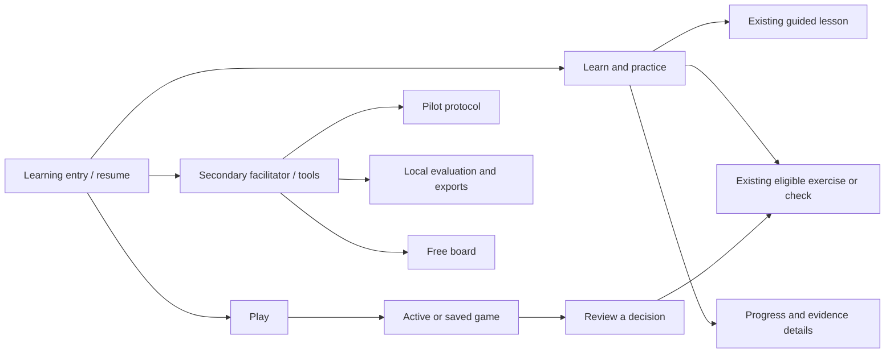

# Design directions and system proposal

These are proposals for approval, not implemented designs. Both directions preserve chess legality, engine integration, curriculum, prerequisite/model decisions, evidence provenance, local storage and accessible alternatives. No new AI, multiplayer, accounts, infrastructure, framework migration or decorative design system is proposed.

## Direction A — refine the existing modules

**Principle:** make today's screens easier to use while retaining their route structure and ownership.

- Keep `/` as the existing guided lesson, `/learn` as adaptive practice/progress, and Play/Review as separate routes.
- Add a clear continuation from lesson completion to existing eligible learning; keep repetition secondary.
- Compact the introductory task and review context; place current feedback close to the board.
- Repair marker contrast, nested board semantics and logical DOM/focus sequence.
- Bind revealed candidates to the original position, retain the retry for comparison, and explain notation locally.
- Group Pilot guide, Local results and free-board utilities under secondary “Facilitator and tools” navigation rather than presenting seven equal next actions.
- Show a concise next-action summary before existing progress/evaluation detail.

**Benefits to test:** less searching/scrolling, easier recovery, fewer accidental mode choices, and a clearer bridge into varied practice. This can improve usability without changing what any answer means.

**Costs/risks:** low to medium relative effort, with most changes confined to existing components. Shared board accessibility work still carries integration risk. The underlying distinction between a legacy guided lesson, adaptive sequence and game workflow remains visible; continued local fixes can recreate duplicated patterns.

**Suitable when:** the immediate need is a bounded supervised pilot and there is limited appetite for route/presentation restructuring.

## Direction B — organize around the learner's next decision

**Principle:** present a coherent learner journey while retaining the existing domain modules underneath it.

A proposed top-level structure:

The diagram is information architecture, not a new domain/service architecture. Review remains directly reachable for returning players; it is also part of a completed game's natural continuation. A small primary navigation could use **Learn, Play, Progress**, with recent/saved review accessible in the game flow and a clearly discoverable Review link where needed. Validate this labeling against **Learn, Play, Review** with Progress inside Learn; do not select labels solely by link count.

### What the learner experiences

1. **A useful entry/resume:** one recommended next learning task with the existing reason and any prerequisite. An unfinished lesson/game/review is available as a clearly named continuation, not an invented course or a new mastery policy.
2. **One consistent learning layout:** task type and question, board, current response and continuation use a stable arrangement. Guided practice, independent check and familiar review remain explicitly different modes.
3. **Game → decision:** the selected game supplies context; game administration and full replay remain available without preceding the reasoning task.
4. **A focused review sequence:** inspect/reflection, candidate, first prediction, result, optional comparison. Completed stages can collapse, but records and the original board remain accessible.
5. **A contextual practice return:** the chosen recommendation is prioritized; prerequisites are explained before the detour and the request survives those steps. Ordinary model recommendations stay available as alternatives.
6. **Progress as explanation and action:** lead with what is due/eligible, distinguish completed activity from independent unfamiliar evidence, and retain the original detailed record/export.
7. **A distinct facilitator entry:** baseline-first study sequencing, timer, exposure prerequisites and export guidance are available without making every ordinary learner navigate a research instrument.

### Compatibility and boundaries

Keep existing URLs during early increments. A later change to `/` from the lesson to a learner entry would require an **explicit routing/compatibility decision**: an explicit lesson location, handling of old bookmarks, preserved query handoffs and correct foreground-timing category mapping. It is not zero-risk or automatically backward compatible. A first increment can establish the learning entry inside `/learn` and update navigation without moving stored lesson data.

Do not change `recommend()`, model thresholds, skill identifiers, verdict policy, curriculum content or source eligibility to make the shell appear smooth. If no fresh exercise exists, report the gap. If a skill requires baseline/prerequisites, explain and preserve the requirement. A new route/view must not silently make familiar positions into independent checks or lose timing/source classification.

The facilitator distinction is presentation and purpose, not a security boundary or a request for authentication. A pilot still requires consent, a separate appropriate profile and approved unexposed content. Ordinary teaching must not be relabeled as an untouched pre-training baseline.

### Benefits, costs and recommendation

| Dimension                 | Direction A                                  | Direction B                                                                                   |
| ------------------------- | -------------------------------------------- | --------------------------------------------------------------------------------------------- |
| Presentation changes      | Local component refinements                  | Shared learner navigation and task orchestration                                              |
| Route disruption          | Low                                          | Moderate if root/lesson meaning later changes; avoid initially                                |
| Data/domain changes       | None required                                | None to chess/learning logic; route-to-existing-evidence/timing mapping needs explicit review |
| Relative engineering cost | Low–medium                                   | Medium–high, delivered in slices                                                              |
| Main risk                 | Module seams remain and overrides accumulate | Navigation/continuation regressions across multiple modes                                     |
| Educational opportunity   | Better visibility and recovery               | More consistent reasoning routine across lessons, games and recovery                          |
| Validation need           | Focused usability and accessibility checks   | Comparative navigation/continuity testing plus the same checks                                |

These cost labels are relative judgments from source inspection, not delivery commitments. Educational benefits are hypotheses to test.

**Recommendation: Direction B, implemented through the small repairs in Direction A first.** The evidence points to journey/context failures rather than a need for new brand artwork, a display font or a dashboard. Start with access correctness, completion handoff and review context. Approve the navigation map and compatibility policy before changing entry-route meaning. Do not launch a broad visual rewrite under the name of refinement.

## Proposed design-system contract

The following values describe a restrained system consistent with the existing brand. They are specifications for a later approved milestone, not edits to tokens.

### Type

| Role                     | Proposed starting specification                          | Guardrail                                                                             |
| ------------------------ | -------------------------------------------------------- | ------------------------------------------------------------------------------------- |
| Main instructional prose | Existing system sans, 16px, line-height roughly 1.5–1.65 | Do not shrink explanations to fit a predetermined card                                |
| Secondary explanation    | 14px, about 1.5–1.65                                     | Prefer disclosure over long blocks of small text                                      |
| Short labels/meta        | 12–14px, sentence case                                   | Small labels must remain readable/high contrast; 12px is not a universal WCAG minimum |
| Task heading             | About 24–28px, weight 650–700                            | The actual question outranks generic product slogans                                  |
| Page heading             | About 28–32px phone, up to 36px desktop                  | Avoid separate large page and task headings repeating the same job                    |
| Board notation           | Existing compact style, tested on both squares           | Preserve coordinates and orientation; do not treat them as decoration                 |

Keep one family and existing fallback behavior. No font download is justified by this audit. Avoid oversized marketing typography, tracked capitals, fake precision or decorative italic words.

### Spacing and layout

- Use the existing 4/8/12/16/24/40px family as the normal spacing vocabulary. Small optical exceptions are acceptable when they help the task.
- Inside one current reasoning step, prefer 8–16px relationships; reserve 24–40px separation for actual changes of task/section. Broad `main > * + *` spacing should not dictate every review phase.
- Retain a centered, capped container near the current 1160px maximum and comfortable 16–24px phone gutters. Instructional paragraphs should generally stay around 45–65ch on wide screens; short labels/questions can be shorter.
- Prefer a desktop board + compact coach region, with the question before the board in DOM order. Mobile should form one logical stack: question/context → board → current response/action. Do not clip necessary content to enforce a fixed screen height.
- Preserve scrolling and reflow at zoom. Any sticky region must be tested for focus obscuration and actual available height; do not adopt a permanently pinned full-size board on a short phone by default.

### Board sizing and states

Keep the successful width behavior observed at 320/390px: approximately 288/358px boards. Retain a comfortable desktop board around 560–640px when space allows, and preserve the existing orientation/notation. The main repair is reducing unrelated content before/around it, not arbitrarily shrinking squares.

At 320px a 36px square meets the 24px dimensional part of the AA target criterion, but provides less touch comfort than 44px. A full board plus generous gutters cannot guarantee 44px cells on every small phone. Preserve click/drag/keyboard alternatives and validate touch accuracy; never claim an impossible size guarantee.

Distinguish focus, selected piece, legal destination, teaching target and feedback annotation. Legal means legal, not safe. Use text/shape alternatives and adequate non-text contrast. First test the existing marker hue at a suitable opacity/edge treatment; do not change the approved board palette without evidence. Verified attack arrows may be disclosed after reasoning/assistance, with a text equivalent and only trusted facts. An attack arrow must not imply a proven blunder or forced loss.

### Navigation and surfaces

- Keep a small learner hierarchy and current-page indication. Retain the accessible menu, Escape behavior, skip link and 44px header controls.
- Separate ordinary tasks from facilitator tools by naming/placement, with no new account system.
- Keep the warm paper/deep green direction and existing dark tokens. Preserve the approved logo and current light/dark rendering.
- Use plain page background for the task, a modest secondary surface for current feedback and native disclosures for supporting evidence. Avoid a card for every paragraph or a generic SaaS dashboard grid.
- Distinguish independent “answer recorded” from correctness. Use words alongside color. Keep caution/analysis uncertainty calm and specific; no fake celebration, streaks or Elo claims.

### Controls and feedback

| Context           | Primary interaction                                        | Secondary/support                          | Boundary                                                                          |
| ----------------- | ---------------------------------------------------------- | ------------------------------------------ | --------------------------------------------------------------------------------- |
| Guided task       | Board response; after feedback, appropriate retry/continue | Method hint, explanation                   | Hints remain available and recorded                                               |
| Independent check | A clearly understood commitment action                     | “I’m not sure” and task instructions       | No correctness/hint/retry leakage before or after the sole independent commitment |
| Active game       | Legal board move                                           | Pause, history, protected end-game actions | No automatic engine evaluations or hints                                          |
| Review            | Current inspection/candidate step; retry when appropriate  | Hint, comparison, original/own-move view   | Reveal remains optional and engine alternatives remain non-unique                 |
| Progress          | Existing next eligible learning action                     | Details/export                             | No mastery from completion or familiar retry                                      |

Do not make “Reveal and compare” the only visually dominant response to an unsuccessful try. Do not block necessary help until a user guesses correctly. The assessment commitment proposal requires separate validation and explicit protocol approval.

Coach presentation should answer **what happened, what is supported, what to inspect next**. Keep uncertainty adjacent to the relevant claim, with detailed method/source information in an accessible disclosure. Candidate lists need a matching board context and a plain description, not only SAN/depth. Focus should announce/identify the result without repeatedly pulling the relevant position away from the visual explanation.

### Responsive and accessibility contract

Verify 320/390/768/1440px in both themes, with short viewport heights and zoom/physical devices added before release. Match meaningful DOM and visual sequence. Maintain one board interaction layer, instant visible focus, adequate markers/text contrast, 24px AA target/spacing rules and preferably 44px ordinary controls. Preserve reduced-motion support and native disclosure semantics. Automated scans, screenshots and accessible-tree snapshots supplement rather than replace screen-reader/device testing.

## What this proposal deliberately leaves open

Real-user preference for primary navigation labels; whether a one-action or select-then-submit independent check best balances intent and burden; the right amount of orientation for rules beginners; compact inline feedback versus a carefully tested board/coach panel; and human suitability of the existing engine presets. Those require observation, not stylistic confidence.
